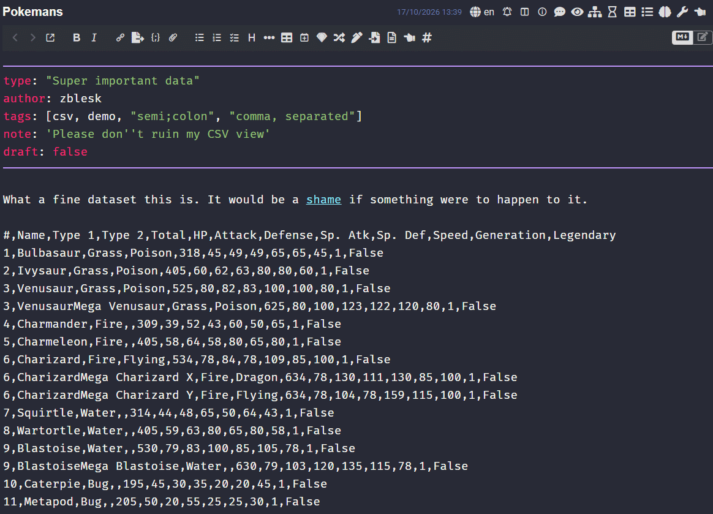

# CSV;Mode

A Joplin plugin that lets you view CSV data as pretty tables.

## Overview

Step one always is telling Joplin that the current note is a CSV via the menu action or note toolbar button.

Paste CSV text into a note, mark the note as CSV, and the editor is replaced by a sortable, filterable grid. The first row of the data is used as the table header.

You have to turn CSV mode on for every note, it won't just barge in by itself. 
Delimiter, quote character and the other option defaults are configured within Joplin's Settings - but you can override for each note and the settings will be remembered.

The grid is built with [AG Grid Community](https://www.ag-grid.com/) and follows Joplin's light or dark theme.

### Getting started

1. Put CSV text into a note.
2. Click the table button in the note toolbar, or use **Tools > Set up CSV mode for this note**.
3. Check the delimiter and the other options in the dialog, then press OK (or Enter).

The note re-opens as a table. (This doesn't seem to be supported quite well in the API - if it doesn't, just switch to a different note and back.)  
To edit the file, use the text mode - use the "Toggle editor plugin" button (eye icon).   
To permanently unmark a file so it's no longer displayed as a CSV, open the same dialog and choose **This is not a CSV**.

## Features

### Table view

- Columns are named after the first row of the data.
- Every column has a filter, and columns can be sorted and resized.
- Quoted fields are supported, including doubled quote characters inside a field and line breaks inside a quoted field. (The line breaks are not show, but will be preserved on copy.)
- Rows shorter than the header are padded with empty cells.
- Completely empty lines are ignored.
- Right-click menu lets you copy values or auto-resize the columns.

### Per-note CSV configuration

The CSV config dialog (toolbar button or **Tools > Set up CSV mode**) has these options:

| Option | Meaning |
| --- | --- |
| Delimiter | The character that separates columns. Enter `\t` or `tab` for a tab character. |
| String escape | The character used to quote fields that contain the delimiter, the quote character or a line break. |
| Lines to skip at start | Number of lines at the beginning of the note to ignore before the CSV data begins. |
| Skip frontmatter | Ignore a leading YAML frontmatter block. |
| Enable row selection | Show checkboxes for selecting rows (see below). |

Notes on the options:

- **Delimiter validation:** the delimiter must be a single character, or a tab spelling (`\t`, `tab`). Anything else is rejected and the dialog is shown again with an error message.
- **Skipping:** frontmatter is removed first, *then* the requested number of lines. (Meaning that if both line skip and frontmatter skip are enabled, the frontmatter lines don't count toward the line skip number.) Frontmatter is a block that starts on the first line with `---` and ends at the next `---` or `...` line. If the note doesn't start with `---`, nothing is removed. The first line left after skipping becomes the header row.
- **Confirming:** pressing Enter in the dialog confirms it.

### Global defaults

Under **Settings > CSV Mode** you can set defaults:

- **Default separator** (default `;`). Enter `\t` or `tab` for a tab.
- **Default string escape** (default `"`).
- **Default lines to skip** (default 0).
- **Skip frontmatter by default** (default on).

A default separator longer than one character can't be used by the parser, so only its first character is used. Row selection has no global default and is off for new notes.

### Right-click menu

Right-clicking the grid opens a menu:

- **Copy cell value** copies the raw text of the cell under the pointer.
- **Copy row value** copies the row as a CSV line, using the note's delimiter and quote character. Fields that need it are quoted. If row selection is on and you right-click one of several ticked rows, all ticked rows are copied, one per line.
- **Enable row selection / Disable row selection** toggles the row checkboxes. The choice is saved in the note config.
- **Clear row selection** appears only while at least one row is ticked and deselects everything.
- **Auto-size columns** fits column widths to the content. Widths are capped at 500 px, and if the columns end up narrower than the grid, they are stretched to fill it.

### Row selection

When enabled, each row gets a checkbox and the header gets a select-all checkbox. Selected rows can be copied from the right-click menu. Turning row selection off clears the current selection.

## Limitations

- The first row after any skipped lines is always treated as the header. 
- The grid is read-only. To change data, edit the note's text without CSV mode. (You can switch to the text view by clicking the built-in eye icon.)
- Ranges of cells can't be selected. Only single cells and whole rows can be copied.
- Auto-sizing measures only the rows currently drawn in the grid, so in very long files the widths reflect the visible rows.
